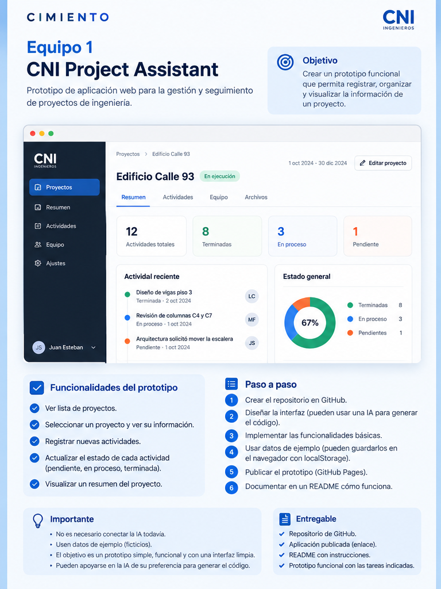

# CNI Project Assistant

**CIMIENTO × CNI Ingenieros** · Primera entrega: **15 de octubre de 2026**

> Gestión y seguimiento de proyectos. Prototipo académico inicial con datos ficticios.

## Objetivo

Construir una aplicación web sencilla, funcional y visualmente cuidada. La imagen es una **referencia**, no un diseño obligatorio.

## Funcionalidades mínimas

- Ver la lista de proyectos.
- Seleccionar un proyecto y consultar sus datos.
- Registrar actividades nuevas.
- Cambiar el estado de cada actividad: pendiente, en proceso o terminada.
- Visualizar un resumen de avances y pendientes.

## Pasos para empezar

1. Revisen la imagen y las [instrucciones de la entrega](docs/instrucciones.pdf).
2. Elijan una IA de su preferencia y pídanle un prototipo web que cumpla las funcionalidades.
3. Lean y entiendan el código generado; ajusten la interfaz a su criterio.
4. Implementen y prueben cada funcionalidad con **datos ficticios**. Pueden usar `localStorage` para guardar datos en el navegador.
5. Suban los archivos al repositorio y publiquen una versión navegable (por ejemplo, GitHub Pages si es un sitio estático).
6. Actualicen este README con las instrucciones reales para ejecutar su versión.

## Tecnologías

Libres. Para comenzar pueden usar **HTML, CSS y JavaScript**, sin necesidad de Bootstrap, Angular ni backend. La IA puede ayudar a generar el código, pero deben poder explicar cómo funciona.

## Entrega

- [ ] Código fuente en GitHub.
- [ ] Prototipo que permita realizar las acciones indicadas.
- [ ] Interfaz ordenada y fácil de usar.
- [ ] Enlace a la aplicación publicada.
- [ ] README actualizado con instrucciones de ejecución y decisiones técnicas.
- [ ] Cada integrante puede explicar su aporte y el código correspondiente.

## Ejecución local

**Pendiente de completar por el equipo.** Si usan HTML/CSS/JS sin herramientas adicionales, bastará con abrir `index.html` en el navegador. Si utilizan un framework, documenten aquí los comandos necesarios.

## Enlace al prototipo

**Pendiente:** agregar URL al publicar.

## Etapas posteriores (no implementar esta semana)

1. Integrar una API de IA (por ejemplo, Gemini o Groq) desde un backend seguro.
2. Evaluar un modelo local con Ollama.
3. Incorporar documentos autorizados de CNI y, si aporta valor, recuperación de información (RAG).

**Importante:** no conecten IA todavía, no incluyan claves API en el repositorio y no utilicen información confidencial de CNI.
